  

# ✂️ Awesome Image Segmentation & Background Removal 🌟

  <strong>Curated collection of state-of-the-art AI image segmentation models, dichotomous segmentation (DIS), neural matting networks, interactive foundation segmentors (SAM 2), and commercial SaaS platforms.</strong>

  
  
  
  
  

  <a href="#-sector-overview--market-dynamics">Sector Overview</a> •
  <a href="#-commercial-saas--cloud-hosted-platforms">Commercial SaaS</a> •
  <a href="#-open-source-libraries--models">Open-Source Models</a> •
  <a href="#-automated-background-removal-libraries--clis">CLIs & Tools</a> •
  <a href="#-interactive--promptable-foundation-models-sam-ecosystem">SAM Ecosystem</a> •
  <a href="#-star-history">Star History</a> •
  <a href="#-support--sponsor">Support</a>

---

## 📌 Table of Contents 📑

- [📊 Sector Overview & Market Dynamics](#-sector-overview--market-dynamics)
- [🏢 Commercial SaaS & Cloud-Hosted Platforms](#-commercial-saas--cloud-hosted-platforms)
- [🚀 Open-Source Libraries & Models](#-open-source-libraries--models)
  - [⚡ Automated Background Removal Libraries & CLIs](#-automated-background-removal-libraries--clis)
  - [🎯 State-of-the-Art Segmentation & Alpha Matting Models](#-state-of-the-art-segmentation--alpha-matting-models)
  - [🔮 Interactive & Promptable Foundation Models (SAM Ecosystem)](#-interactive--promptable-foundation-models-sam-ecosystem)
  - [🌐 Browser-Based & WebGPU Client-Side Background Removers](#-browser-based--webgpu-client-side-background-removers)
  - [🎬 Video Background Removal & Real-Time Matting](#-video-background-removal--real-time-matting)
- [📈 Star History](#-star-history)
- [💖 Support & Sponsor](#-support--sponsor)
- [🤝 Contributing](#-contributing)

---

## 📊 Sector Overview & Market Dynamics 🌐

The global AI image editing, visual AI, and automated segmentation market is estimated at **$1.8 billion to $3.2 billion**, expanding at an aggressive CAGR of **18.5%–24.2%** through 2030. The industry is primarily accelerated by high-velocity e-commerce product catalogs, generative AI pipelines, virtual photo studios, advertising tech, and digital creator workflows.

The sector demonstrates **moderate fragmentation shifting rapidly toward bundling and ecosystem convergence**:
1. **Commoditization of Standalone Cutouts**: Pure single-click background removal utilities are increasingly commoditized by powerful open-weights foundation models (such as BiRefNet, RMBG, and SAM 2) running at zero inference cost on consumer hardware or directly in client browsers via WebGPU.
2. **Defensible Vertical SaaS & Ecosystem Giants**: Dominant horizontal platforms (Adobe Express/Photoshop, Canva) capture mass-market design workflows by bundling cutout engines natively. Simultaneously, vertical specialized platforms (such as Photoroom for automated commercial merchandise staging) defend pricing power through end-to-end catalog generation, AI relighting, shadows, and batch enterprise APIs.

---

## 🏢 Commercial SaaS & Cloud-Hosted Platforms 💼

Commercial cloud-hosted AI background removers, enterprise visual asset APIs, and design suites sorted by company size (market valuation / parent revenue, descending):

| Platform | Company Valuation / Revenue | Description | Pricing Model | Free Tier & Limits |
| :--- | :--- | :--- | :--- | :--- |
| **[Adobe Express](https://adobe.com)** | **$215 Billion** (Adobe Inc. Market Cap) | Cloud-hosted creative suite featuring one-click background extraction driven by Photoshop algorithms & Adobe Firefly. | Freemium; Premium plan starts at **$9.99/mo** | Free forever plan with basic background removal and **25 monthly generative credits**. |
| **[Canva](https://canva.com)** | **$26 Billion** (Valuation) | All-in-one graphic design and visual marketing workspace featuring instant background removal across templates and assets. | Canva Pro starts at **$12.99/mo** (or $119.99/yr) | **30-day free trial** of Canva Pro with full access to background remover; free plan does not include cutout tools. |
| **[Clipdrop](https://clipdrop.co)** | **$1.5 Billion** (Jasper AI Parent Valuation) | High-throughput AI imaging suite providing high-definition background removal, object removal, and relighting. | Freemium; Pro starts at **$7.00/mo** (billed annually) or $13.00/mo | Free tier with **watermarked / 1024x1024 max resolution** output and daily rate limit of 10 operations. |
| **[Photoroom](https://photoroom.com)** | **$500 Million** (Valuation) | AI commerce photography suite with automatic background isolation, batch product editing, AI backgrounds, and shadows. | Freemium; Pro starts at **$9.99/mo** (or $69.99/yr) | Free forever web/mobile tier with standard resolution exports, basic tools, and **Photoroom watermark**. |
| **[Remove.bg](https://remove.bg)** | **$120 Million+** (Kaleido AI / Canva) | Pioneer cloud AI background removal service offering high-throughput REST APIs, desktop tools, and e-commerce plugins. | Pre-paid or Subscription starting at **$9.00/mo** (for 40 credits) | Free forever account: **1 free high-res download credit**, plus unlimited free low-res (up to 0.25 megapixel / 625x400) web previews. |
| **[Pixlr](https://pixlr.com)** | **$100 Million** (Inmagine Group Parent Valuation) | Browser-based photo editor featuring AI cutout, batch background erasing, and smart selection tools. | Freemium; Plus starts at **$1.99/mo**, Premium at **$7.99/mo** | Free forever plan with standard editing tools, banner ads, and **limited to 3 daily saves/exports**. |
| **[Cutout.pro](https://cutout.pro)** | **$35 Million** (Estimated Valuation) | Commercial visual AI developer platform offering background removal, ID photo maker, and face segmentation APIs. | Subscription starts at **$9.90/mo** (for 100 credits) or pay-as-you-go | Free tier gives **5 free initial download credits** on sign-up; unlimited low-resolution web previews. |
| **[Slazzer](https://slazzer.com)** | **$20 Million** (Estimated Valuation) | Automated background remover offering desktop apps, Zapier integrations, WooCommerce plugins, and REST APIs. | Subscription starts at **$13.00/mo** (for 100 credits) or $0.13/image | Free account provides **2 free high-res image credits** upon registration and unlimited low-res preview conversions. |
| **[Erase.bg](https://erase.bg)** | **$15 Million** (PixelBin / Fynd / Reliance) | AI-powered background remover optimized for product imagery, social media portraits, and developer image pipelines. | Subscription starts at **$9.00/mo** (for 100 credits) or pay-as-you-go | Free forever tier includes **3 free high-resolution transformation credits** upon sign-up; free low-res previews. |
| **[Photopea](https://photopea.com)** | **$10 Million** (Estimated Valuation) | Advanced browser-based raster/vector editor featuring magic cut, AI select subject, and batch export tools. | 100% Free (Ad-supported) or Premium at **$5.00/mo** (removes ads) | **100% free forever** with all features included, supported by display banner ads; 30-step undo limit. |

---

## 🚀 Open-Source Libraries & Models 💻

Curated open-source deep learning models, dichotomous segmentation tools, neural matting networks, and edge apps. Repositories in each section are sorted by GitHub_Stars in descending order.

### ⚡ Automated Background Removal Libraries & CLIs

| Project | GitHub_Stars | Description |
| :--- | :--- | :--- |
| **[rembg](https://github.com/danielgatis/rembg)** |  | The industry-standard Python library, CLI, and HTTP server for image background removal with support for U2-Net, IS-Net, and BiRefNet. |
| **[backgroundremover](https://github.com/nadermx/backgroundremover)** |  | Powerful command-line tool and library to remove background from images and video using AI and Torchvision backbones. |
| **[image-background-remove-tool (CarveKit)](https://github.com/OPHoperHPO/image-background-remove-tool)** |  | Automated high-quality background removal framework combining Tracer-B7, U2-Net, and FBA Matting for ultra-crisp edges. |
| **[transparent-background](https://github.com/plemeri/transparent-background)** |  | Production-ready background removal tool powered by InSPyReNet (ACCV 2022) with real-time video and image support. |
| **[withoutbg-python](https://github.com/withoutbg/withoutbg-python)** |  | Fast, privacy-centric Python SDK and CLI for seamless local and cloud-assisted background isolation workflows. |
| **[ComfyUI-Inspyrenet-Rembg](https://github.com/john-mnz/ComfyUI-Inspyrenet-Rembg)** |  | Highly popular ComfyUI custom node implementing InSPyReNet for rapid background extraction inside generative diffusion pipelines. |
| **[Peel](https://github.com/TuguiDragos/Peel)** |  | Clean, lightweight open-source subject isolation pipeline and utility designed for minimal memory footprints. |

### 🎯 State-of-the-Art Segmentation & Alpha Matting Models

| Model / Framework | GitHub_Stars | Description |
| :--- | :--- | :--- |
| **[U-2-Net](https://github.com/xuebinqin/U-2-Net)** |  | Groundbreaking nested U-structure deep neural network for high-accuracy salient object detection and background separation. |
| **[PaddleSeg](https://github.com/PaddlePaddle/PaddleSeg)** |  | End-to-end high-performance image segmentation library supporting semantic, interactive, panoptic, and fine alpha matting. |
| **[BiRefNet](https://github.com/ZhengPeng7/BiRefNet)** |  | SOTA Bilateral Reference Network for high-resolution dichotomous image segmentation delivering razor-sharp hair cutouts. |
| **[MODNet](https://github.com/ZHKKKe/MODNet)** |  | Real-time trimap-free portrait matting solution capable of 67 FPS inference on consumer GPUs (AAAI 2022). |
| **[DIS (Highly Accurate DIS)](https://github.com/xuebinqin/DIS)** |  | Official IS-Net codebase for Dichotomous Image Segmentation (DIS), capturing micro-structures and complex transparency. |
| **[ComfyUI-RMBG](https://github.com/1038lab/ComfyUI-RMBG)** |  | Comprehensive ComfyUI segmentation studio bundling RMBG-2.0, InSPyReNet, BiRefNet, and GroundingDINO. |
| **[image-matting](https://github.com/pangxiaobin/image-matting)** |  | Complete AI matting, format conversion, and ID photo creation tool with automated background synthesis. |
| **[Deep-Image-Matting](https://github.com/foamliu/Deep-Image-Matting)** |  | Clean, robust PyTorch implementation of the landmark CVPR Deep Image Matting paper with trimap generation. |
| **[Matte-Anything](https://github.com/hustvl/Matte-Anything)** |  | Interactive natural image matting pipeline integrating Segment Anything Models for prompt-guided alpha matte extraction. |
| **[ViTMatte](https://github.com/hustvl/ViTMatte)** |  | Boosting image matting using plain Vision Transformers (ViT) achieving pristine sub-pixel hair and fur boundaries. |

### 🔮 Interactive & Promptable Foundation Models (SAM Ecosystem)

| Foundation Model | GitHub_Stars | Description |
| :--- | :--- | :--- |
| **[Segment Anything (SAM - Meta)](https://github.com/facebookresearch/segment-anything)** |  | Meta AI's foundational promptable vision model that revolutionized zero-shot interactive object segmentation. |
| **[Segment Anything Model 2 (SAM 2 - Meta)](https://github.com/facebookresearch/sam2)** |  | Unified foundation model for real-time visual segmentation across images and videos with continuous memory attention. |
| **[Grounded-Segment-Anything](https://github.com/IDEA-Research/Grounded-Segment-Anything)** |  | Grounded-SAM marries Grounding DINO with SAM & Stable Diffusion to detect, segment, and isolate anything via text prompts. |
| **[X-AnyLabeling](https://github.com/CVHub520/X-AnyLabeling)** |  | Cross-platform desktop annotation and segmentation suite integrating SAM 2, YOLOv8/11, and BiRefNet for automated masking. |
| **[FastSAM](https://github.com/CASIA-LMC-Lab/FastSAM)** |  | CNN-based real-time alternative to Segment Anything, achieving 50x faster inference speed for interactive segmentation. |
| **[MobileSAM](https://github.com/ChaoningZhang/MobileSAM)** |  | Lightweight mobile-friendly Segment Anything implementation running orders of magnitude faster on edge mobile CPUs/GPUs. |
| **[AnyLabeling](https://github.com/vietanhdev/anylabeling)** |  | AI-assisted labeling and segmentation desktop app with out-of-the-box SAM, SAM 2, and MobileSAM support. |
| **[ISAT with SAM](https://github.com/yatengLG/ISAT_with_segment_anything)** |  | Semi-automatic interactive image annotation and subject extraction application powered by Segment Anything models. |

### 🌐 Browser-Based & WebGPU Client-Side Background Removers

| Project | GitHub_Stars | Description |
| :--- | :--- | :--- |
| **[Transformers.js (Hugging Face)](https://github.com/huggingface/transformers.js)** |  | Run state-of-the-art vision models (RMBG, SegFormer, SAM) client-side in the browser via WebGPU with 0 server latency. |
| **[@imgly/background-removal-js](https://github.com/imgly/background-removal-js)** |  | Seamless JavaScript library executing 100% in-browser AI background removal with ONNX Runtime Web and WebGPU. |
| **[bg-remove (Addy Osmani)](https://github.com/addyosmani/bg-remove)** |  | Free, private, client-side background removal web application powered by Transformers.js and modern WebGPU pipelines. |
| **[bg0](https://github.com/opencoredev/bg0)** |  | Private, zero-server-upload, unlimited background removal web tool executing fully inside your local browser. |
| **[cut-it-out](https://github.com/Suvink/cut-it-out)** |  | Interactive browser-based background removal application engineered for fast client-side inference. |

### 🎬 Video Background Removal & Real-Time Matting

| Project | GitHub_Stars | Description |
| :--- | :--- | :--- |
| **[Robust Video Matting (RVM)](https://github.com/PeterL1n/RobustVideoMatting)** |  | Robust, temporally coherent human video matting model running at 4K 60FPS / HD 104FPS in real time without green screens. |
| **[BackgroundMattingV2](https://github.com/PeterL1n/BackgroundMattingV2)** |  | Ultra high-resolution real-time background matting taking an additional static background capture for studio-grade isolation. |
| **[obs-backgroundremoval](https://github.com/royshil/obs-backgroundremoval)** |  | Real-time background removal and virtual green screen plugin for OBS Studio running natively on GPU/CPU. |

---

## 📈 Star History 🌟

---

## 💖 Support & Sponsor ☕

If this curated repository saved you time, helped you benchmark segmentation models, or assisted your computer vision project, please consider supporting the project!

- ⭐ **Star this repository** to help others discover it on GitHub.
- 🍴 **Fork and share** with colleagues, ML engineers, and vision researchers.
- ☕ **Sponsor / Buy Me a Coffee**: Help sustain open-source maintenance and curated benchmarks via the [GitHub Sponsors Dashboard](https://github.com/sponsors/ishandutta2007).

---

## 🤝 Contributing 💡

Contributions are warmly welcomed! Please read these steps to contribute new image segmentation models, dichotomous segmentation architectures, or WebGPU tools:

1. 🍴 **Fork the repository**.
2. 🌿 **Create a descriptive feature branch** (`git checkout -b add-model-name`).
3. 📝 **Add your project** under the appropriate category maintaining alphabetical order or star-count order with concise descriptions.
4. 🚀 **Submit a Pull Request** with a clear explanation of your addition.

---

Maintained with ❤️ by [Ishan Dutta](https://github.com/ishandutta2007) • Licensed under [MIT](LICENSE)

